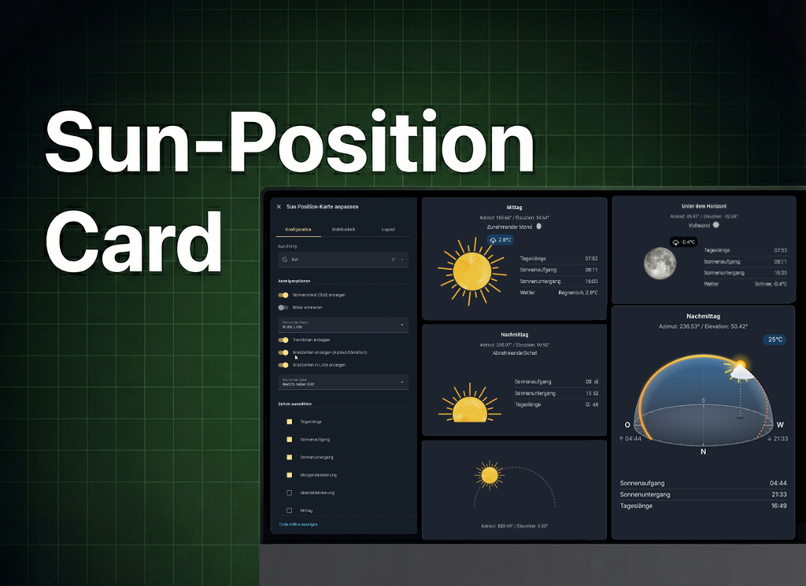
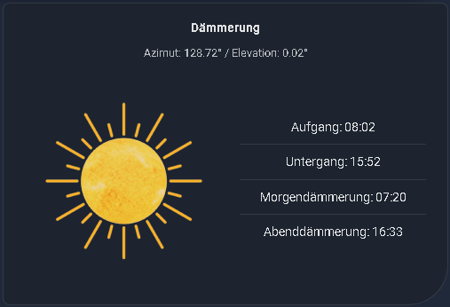
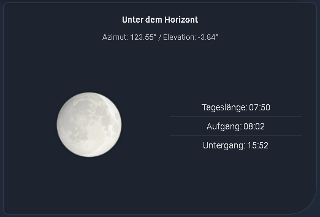
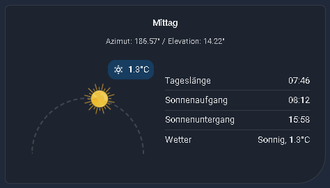
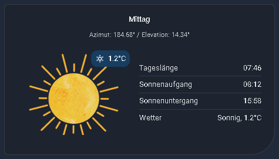
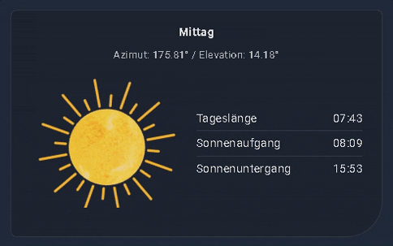
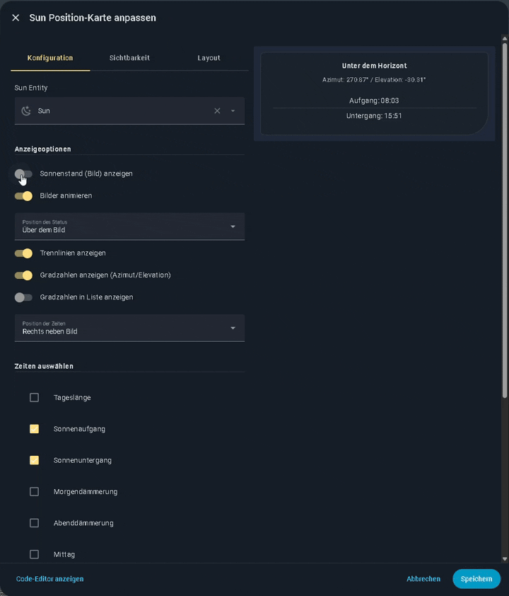
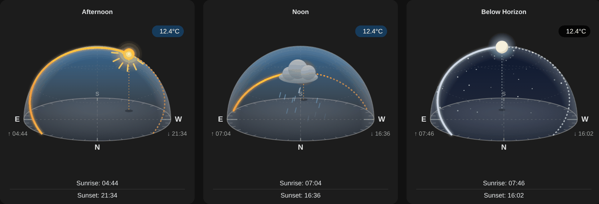

[](https://github.com/hacs/plugin)
[](https://github.com/jayjojayson/Sun-Position-Card/actions?query=workflow%3Avalidate)
 
[](https://github.com/jayjojayson/Sun-Position-Card/releases/)
[](https://github.com/jayjojayson/Sun-Position-Card/blob/main/docs/README-de.md)
[](https://www.paypal.me/quadFlyerFW)




[](https://ko-fi.com/G2G01VCROJ) 

[](https://community.home-assistant.io/t/sun-moon-position-card-another-implementation/965201)
[](https://community-smarthome.com/t/custom-sun-position-card-fuer-home-assistant-sonnenstand-card-hacs/9389)

---


# :sunny: Sun Position Card

The Sun Position Card is a custom Lovelace Card that visualizes the current sun position with various options, as well as the current moon phase and other relevant solar times. 
The card is fully configurable via the card editor interface. You will need the `sun.sun` entity, which is provided by Home Assistant once your home location is configured. 
The moon phase sensor (usually `sensor.moon_phase`) is optional and is only required to display the current moon phase.

To get the moon sensor, go to Settings → Devices & Services → Add integration and search for "Moon." This is Home Assistant's built-in moon integration.

Translations for English, German, French, Italian, Dutch, Polish, Czech, Russian, Spanish, Swedish, Brazilian Portuguese and Danish are included. If you need another translation, open an issue with the [translation template](https://github.com/jayjojayson/Sun-Position-Card/issues/new?template=add-translation.md).

If you like the Card, I would appreciate a Star rating ⭐ from you. 🤗

## Features
- ### 🔆 **Sun Position – Classic Display**
- ### 🌅 **Sun Position – Calculated Display**
- ### 🌄 **Sun Position – Calculated Arc**
- ### 🌙 **Moon Phases – Visual Display**
- ### 🎞️ **Animated Sun Position**
- ### ⏰ **Customizable Times**
- ### 🌤️ **Weather Status**
- ### 📐 **Flexible Layout**
- ### 📍 **Adjustable Thresholds**
- ### ⚙️ **UI Configuration**
- ### 🌐 **Manual Language Selection** 
- ### 🔋 **Solar Power Badge**
- ### 🌐 **NEW: 3D Dome with real Sun & Moon Path**
- ### 🌦️ **NEW: Animated Weather Effects over Sun and Moon**
- ### 🌏 **Southern Hemisphere Support**
- ### 🔢 **Rounding for Temperature and Solar Power**
- ### 🆕 **Dropdowns compatible with HA 2026.3+** 
---

 
 

<details>
  <summary> <b>Have a look at the animated card</b></summary>  
  

</details>

---

## Installation

### HACS (Recommended)

- Add this repository to HACS. To do so, use the following link.

 [](https://my.home-assistant.io/redirect/hacs_repository/?owner=jayjojayson&repository=Sun-Position-Card&category=plugin)

- The "Sun Position Card" should now be available in HACS. Click "INSTALL".
- The resource will be added to your Lovelace configuration automatically.

<details>
  <summary> <b>Manual Installation via Hacs</b></summary>  

1.  Open HACS in Home Assistant.
2.  Go to "Frontend" and click the three dots in the top right corner.
3.  Select "Custom repositories".
4.  Add the URL to your GitHub repository and select "Lovelace" as the category.
5.  Click "ADD".
6.  The "Sun Position Card" should now be available in HACS. Click "INSTALL".
7.  The resource will be added to your Lovelace configuration automatically.
</details>

<details>
  <summary> <b>Manual Installation in HA</b></summary>  

### Manual Installation

1.  Download `sun-position-card.js` from the [latest release](https://github.com/jayjojayson/Sun-Position-Card/releases/latest) (or from the `dist` folder). This single file already contains the editor, all translations and all images.
2.  Place `sun-position-card.js` in `config/www/community/Sun-Position-Card/`. You will have to create the `community` and `Sun-Position-Card` folders.
3.  Add the resource to your Lovelace configuration through the Home Assistant UI:
    a. Go to "Settings" -> "Dashboards".
    b. Click on the three dots in the top right corner and select "Resources".
    c. Click on "+ ADD RESOURCE".
    d. Enter `/local/community/Sun-Position-Card/sun-position-card.js` as the URL and select "JavaScript Module" as the Resource type.
    e. Click "CREATE".
4.  Restart Home Assistant.
</details>

---

## Configuration



Although the UI configuration is recommended, the card can also be configured manually using the YAML editor:

### Options

| Name                     | Type      | Default                       | Description |
| ------------------------ | --------- | ----------------------------- | ----------- |
| `type`                   | `string`  | **required**                  | `custom:sun-position-card` |
| `entity`                 | `string`  | **required**                  | The sun entity, usually `sun.sun`. |
| `moon_entity`            | `string`  |                               | Moon phase sensor, usually `sensor.moon_phase`. |
| `weather_entity`         | `string`  |                               | Weather entity for the weather badge and the `weather` entry. |
| `temp_entity`            | `string`  |                               | Temperature sensor, overrides the temperature of the weather entity. |
| `temperature_decimals`   | `number`  | no rounding                   | Decimal places for the temperature (`0` – `3`). |
| `solar_entity`           | `string`  |                               | Solar power sensor for the solar badge. |
| `solar_decimals`         | `number`  | no rounding                   | Decimal places for the solar power (`0` – `3`). |
| `show_weather_badge`     | `boolean` | `true`                        | Show the weather badge on the image. |
| `show_weather_overlay`   | `boolean` | `false`                       | Animated weather effects over the sun/moon (requires `weather_entity`). |
| `show_solar_badge`       | `boolean` | `true`                        | Show the solar power badge on the image. |
| `view_mode`              | `string`  | `classic`                     | `classic` (6 images), `calculated` (elevation), `arc` (180° arc) or `dome` (3D dome). |
| `sun_size`               | `number`  | `50`                          | Size of sun/moon in px (arc view only). |
| `show_dome_times`        | `boolean` | `false`                       | Show sunrise below E and sunset below W (dome view only). |
| `show_image`             | `boolean` | `true`                        | Show the sun position image. |
| `animate_images`         | `boolean` | `false`                       | Animate the sun images. |
| `state_position`         | `string`  | `in_list`                     | Position of the current state: `above`, `in_list`, `hide`. |
| `moon_phase_position`    | `string`  | `in_list`                     | Position of the moon phase text: `above`, `in_list`. |
| `hide_moon_phase_on_day` | `boolean` | `false`                       | Hide the moon phase during the day. |
| `show_night_arc`         | `boolean` | `false`                       | Show the moon on an arc at night. |
| `show_moon_icon_in_text` | `boolean` | `false`                       | Show a moon icon next to the moon phase text. |
| `times_to_show`          | `list`    | `next_rising`, `next_setting` | `daylight_duration`, `day_comparison`, `next_rising`, `next_setting`, `next_dawn`, `next_dusk`, `next_noon`, `next_midnight`, `next_moonrise`, `next_moonset`, `moon_phase`, `weather` |
| `time_position`          | `string`  | `below`                       | Position of the times: `above`, `below`, `right`. |
| `time_list_format`       | `string`  | `centered`                    | Alignment of the time list: `centered`, `block`. |
| `show_degrees`           | `boolean` | `false`                       | Show azimuth and elevation. |
| `show_degrees_in_list`   | `boolean` | `false`                       | Show azimuth and elevation in the time list. |
| `show_dividers`          | `boolean` | `true`                        | Show dividers between the times. |
| `use_12h_format`         | `boolean` | `false`                       | Use the 12-hour format (AM/PM). |
| `language`               | `string`  | Home Assistant language       | `de`, `en`, `fr`, `it`, `nl`, `pl`, `cs`, `ru`, `sv`, `es`, `pt`, `da` |
| `hemisphere`             | `string`  | `auto`                        | `auto` (from the latitude of your HA location), `north` or `south`. YAML only. |
| `morning_azimuth`        | `number`  | `150`                         | Azimuth threshold for morning. |
| `noon_azimuth`           | `number`  | `200`                         | Azimuth threshold for noon. |
| `afternoon_azimuth`      | `number`  | `255`                         | Azimuth threshold for afternoon. |
| `dusk_elevation`         | `number`  | `10`                          | Elevation threshold for dawn/dusk. |

#### 3D dome view



With `view_mode: dome` the card shows a 3D sky dome over a compass. During the day you see today's real sun path (already passed: solid, still to come: dotted) and the sun with its drop line to the ground. At night the moon path and the moon with its current phase are shown, with a starry sky. If the moon is still below the horizon, it is not shown; instead its upcoming path and the moonrise time at the rising point are shown. Moonrise and moonset can also be added to the time list (`next_moonrise`, `next_moonset`); they are calculated from your HA location. In the arc view with the moon arc enabled, the moon now follows its real path from moonrise (left) to moonset (right). Both paths are calculated from the location of your Home Assistant instance. The sky changes its colors for day, twilight and night. With `show_dome_times: true` the sunrise time is shown below E and the sunset time below W.

#### Animated weather effects

With a weather entity and `show_weather_overlay: true`, an animated layer is shown over the sun or moon: sun rays, clouds, rain, heavy rain, snow, sleet, hail, thunderstorm with lightning, fog, wind or twinkling stars – depending on the state of your weather entity. It works in all view modes. If your device has "reduce motion" enabled, the effects are shown without animation.

```yaml
type: custom:sun-position-card
entity: sun.sun
moon_entity: sensor.moon_phase
weather_entity: weather.home
view_mode: dome
show_dome_times: true
show_weather_overlay: true
```

#### Southern hemisphere

The card detects the southern hemisphere automatically from the latitude of your Home Assistant location:

- The time of day (morning, noon, afternoon, evening) is calculated correctly, although the sun is in the north at noon. The azimuth thresholds keep the same values as on the northern hemisphere.
- Moon images and moon icons are shown rotated by 180°, as the moon is seen from the southern hemisphere.
- The 3D dome looks to the north, where the sun passes at noon.

If the detection does not fit your setup, you can force it in YAML with `hemisphere: north` or `hemisphere: south`.


simple example:

```yaml
type: custom:sun-position-card
entity: sun.sun
times_to_show:
  - next_rising
  - next_setting
time_position: right
show_image: false
```

advanced example:

```yaml
type: custom:sun-position-card
entity: sun.sun
moon_entity: sensor.moon_phase
moon_phase_position: above
state_position: above
show_dividers: true
show_degrees: true
show_degrees_in_list: false
times_to_show:
  - next_rising
  - next_setting
  - daylight_duration
  - moon_phase
time_position: right
show_image: true
morning_azimuth: 155
dusk_elevation: 5
noon_azimuth: 200
afternoon_azimuth: 255
animate_images: false
time_list_format: block
view_mode: arc
```

---

## CSS elements you can target for styling:

| Selector                | Description                                                                 |
| ----------------------- | --------------------------------------------------------------------------- |
| `ha-card`               | The entire card container.                                                  |
| `.card-content`         | The main container wrapping all elements inside the card.                   |
| `.sun-image-container`  | The container `<div>` for the sun image.                                    |
| `.sun-image`            | The image `` element itself.                                           |
| `.times-container`      | The container for the list of times.                                        |
| `.time-entry`           | An individual row/entry in the times list (e.g., "Aufgang: 06:30").         |
| `.state`                | The current state text (e.g., "Mittag") when positioned above the image.    |
| `.moon-phase-state`     | The current state text (e.g., "Full-Moon") when positioned above the image. |
| `.degrees`              | The Azimuth/Elevation text when positioned above the image.                 |
| `.degrees-in-list`      | The Azimuth/Elevation text when positioned inside the times list.           |
| `.divider`              | The horizontal line `<hr>` used as a separator between time entries.        |


### Examples

Here are some examples of how you can use `card-mod` in the YAML configuration of your card.

#### Change Fontsize and Color


```yaml
type: custom:sun-position-card
entity: sun.sun
state_position: above # State must be 'above' to see the effect on .state
card_mod:
  style: |
    .state {
      font-size: 24px;
      color: dodgerblue;
    }
    .time-entry {
      font-size: 14px;
      color: #888;
    }
```

#### Edit Image


```yaml
type: custom:sun-position-card
entity: sun.sun
card_mod:
  style: |
    .sun-image {
      border: 2px solid var(--primary-color);
      border-radius: 10px;
      opacity: 0.9;
    }
```

#### Change Background and remove Shadows


```yaml
type: custom:sun-position-card
entity: sun.sun
card_mod:
  style: |
    ha-card {
      background: #FFFACD;
      box-shadow: none;
    }
```

#### Edit Divider


```yaml
type: custom:sun-position-card
entity: sun.sun
show_dividers: true
card_mod:
  style: |
    .divider {
      border-top: 2px dashed red;
    }
```

---

## Contributors

Thanks to everyone who contributed to this card:

- [@undel-gh](https://github.com/undel-gh) – Russian translation, integration of the Spanish, Swedish and Brazilian Portuguese translations, improved time, temperature and solar badge handling
- [@gerd-goemans](https://github.com/gerd-goemans) – option to round the temperature

### Translations

- Czech: [@Tarasa24](https://github.com/Tarasa24), [@krenstik](https://github.com/krenstik)
- Spanish: [@Kepinardo](https://github.com/Kepinardo)
- Brazilian Portuguese: [@vodikus](https://github.com/vodikus)
- Swedish: [@MatAhman](https://github.com/MatAhman)
- Danish: [@strickeraxelsen](https://github.com/strickeraxelsen)
- Russian: [@undel-gh](https://github.com/undel-gh)

Thanks also to everyone who reported bugs and shared ideas.
