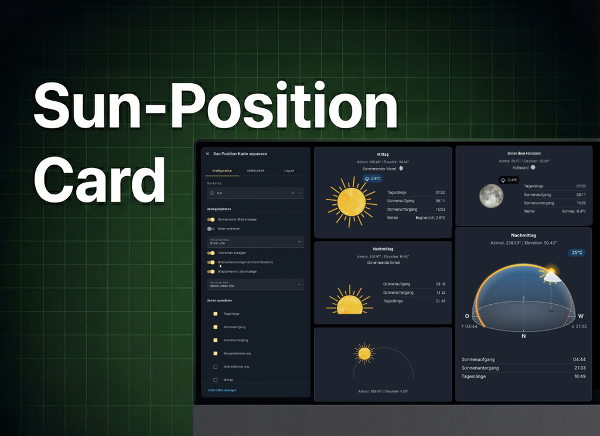
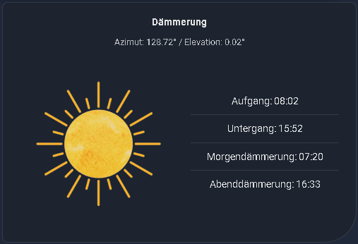
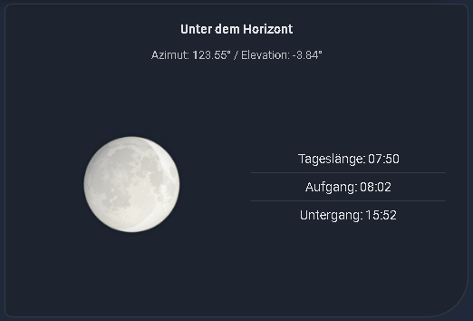
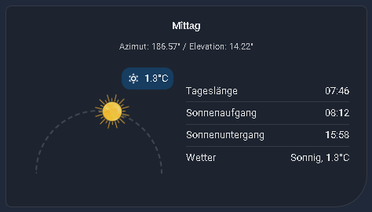
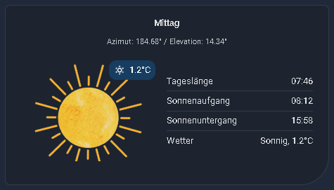
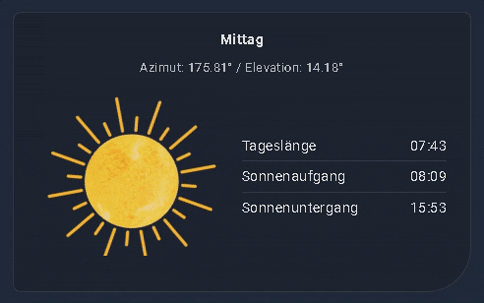
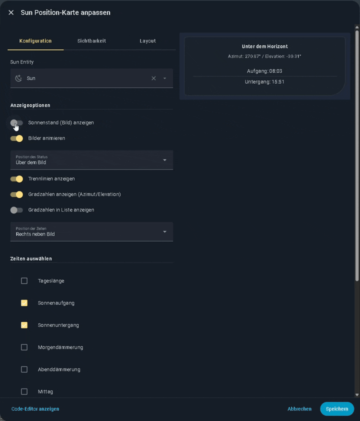
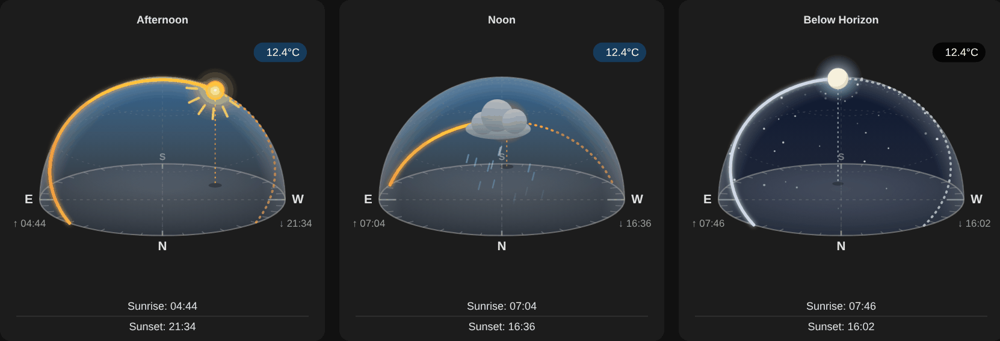
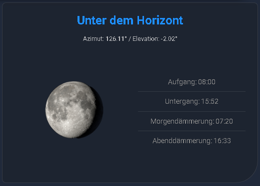

[](https://github.com/hacs/plugin)
[](https://github.com/jayjojayson/Sun-Position-Card/actions?query=workflow%3Avalidate)
 
[](https://github.com/jayjojayson/Sun-Position-Card/releases/)
[](https://github.com/jayjojayson/Sun-Position-Card/blob/main/docs/README-de.md)
[](https://www.paypal.me/quadFlyerFW)




[](https://ko-fi.com/G2G01VCROJ) 

[](https://community.home-assistant.io/t/sun-moon-position-card-another-implementation/965201)
[](https://community-smarthome.com/t/custom-sun-position-card-fuer-home-assistant-sonnenstand-card-hacs/9389)


---

Die 🔆 Sun Position Card ist eine benutzerdefinierte Lovelace-Karte zur Visualisierung der aktuellen Sonnenposition mit verschiedenen Optionen, sowie der aktuellen Mondphase und Anzeige weiterer relevanter Sonnenzeiten.  

Die Karte ist vollständig über die Benutzeroberfläche des Karteneditors konfigurierbar.
Du benötigst die sun.sun-Entität, die von Home Assistant bereitgestellt wird, sobald dein Home-Standort konfiguriert ist. Die moon.phase-Entität ist optional und wird nur benötigt, um die aktuelle Mondphase anzuzeigen.
Um den Mond-Sensor zu erhalten, gehe zu Einstellungen → Geräte & Dienste → Integration hinzufügen und suche nach Mond. Dies ist die integrierte Mond-Integration von Home Assistant.

Übersetzungen für Englisch, Deutsch, Französisch, Italienisch, Niederländisch, Polnisch, Tschechisch, Russisch, Spanisch, Schwedisch, Brasilianisches Portugiesisch und Dänisch sind enthalten. Für weitere Sprachen kannst du ein Issue mit der [Übersetzungs-Vorlage](https://github.com/jayjojayson/Sun-Position-Card/issues/new?template=add-translation.md) erstellen.

Wenn euch die custom Card gefällt, würde ich mich sehr über eine Sternebewertung ⭐ freuen. 🤗

## Features

- ### 🔆 **Sonnestand klassische Darstellung**
- ### 🌅 **Sonnestand berechnete Darstellung**
- ### 🌄 **Sonnestand berechneter Bogen**
- ### 🌙 **Mondphasen – visuelle Darstellung**
- ### 🎞️ **Animierter Sonnenstand**
- ### ⏰ **Anpassbare Zeiten**
- ### 🌤️ **Wetter Status**
- ### 📐 **Flexibles Layout**
- ### 📍 **Anpassbare Schwellenwerte**
- ### ⚙️ **UI-Konfiguration**
- ### 🌐 **Manuelle Sprachauswahl** 
- ### 🔋 **Solarleistungs-Badge** 
- ### 🌐 **NEU: 3D-Kuppel mit echter Sonnen- und Mondbahn**
- ### 🌦️ **NEU: Animierte Wettereffekte über Sonne und Mond**
- ### 🌏 **Unterstützung für die Südhalbkugel**
- ### 🔢 **Rundung für Temperatur und Solarleistung**
- ### 🆕 **Dropdowns kompatibel mit HA 2026.3+**
---


 
 

<details>
  <summary> <b>Animierte Card anschauen</b></summary>  
  

</details>


---

## Installation

### HACS (Empfohlen)

- Das github über den Link in Home Assistant einfügen.
 
  [](https://my.home-assistant.io/redirect/hacs_repository/?owner=jayjojayson&repository=Sun-Position-Card&category=plugin)

- Die "Sun Position Card" sollte nun in HACS verfügbar sein. Klicke auf "INSTALLIEREN" ("INSTALL").
- Die Ressource wird automatisch zu deiner Lovelace-Konfiguration hinzugefügt.

<details>
  <summary> <b>Manuelle Installation über Hacs</b></summary>  

### Manuelle Installation über Hacs 
Öffne HACS in Home Assistant.

- Gehe zu "Frontend" und klicke auf die drei Punkte in der oberen rechten Ecke.
- Wähle "Benutzerdefinierte Repositories" ("Custom repositories") aus.
- Füge die URL zu Ihrem GitHub-Repository hinzu und wähle "Lovelace" als Kategorie.
- Klicke auf "HINZUFÜGEN" ("ADD").
- Die "Sun Position Card" sollte nun in HACS verfügbar sein. Klicke auf "INSTALLIEREN" ("INSTALL").
- Die Ressource wird automatisch zu deiner Lovelace-Konfiguration hinzugefügt.
</details>

<details>
  <summary> <b>Manuelle Installation in HA</b></summary>  
 
### Manuelle Installation in HA
1.  **Datei herunterladen:**
    *   Lade die `sun-position-card.js` aus dem [aktuellen Release](https://github.com/jayjojayson/Sun-Position-Card/releases/latest) (oder aus dem Ordner `dist`) herunter. Diese eine Datei enthält bereits den Editor, alle Übersetzungen und alle Bilder.

2.  **Datei in Home Assistant hochladen:**
    *   Erstelle die Ordner `community/Sun-Position-Card` im `www`-Verzeichnis deiner Home Assistant-Konfiguration. (Das `www`-Verzeichnis befindet sich im selben Ordner wie deine `configuration.yaml`).
    *   Kopiere die Datei in diesen Ordner:
        ```
        /config/www/community/Sun-Position-Card/sun-position-card.js
        ```

3.  **Ressource zu Home Assistant hinzufügen:**
    *   Gehe in Home Assistant zu **Einstellungen > Dashboards**.
    *   Klicke auf das Menü mit den drei Punkten oben rechts und wähle **Ressourcen**.
    *   Klicke auf **+ Ressource hinzufügen**.
    *   Gebe als URL `/local/community/Sun-Position-Card/sun-position-card.js` ein.
    *   Wähle als Ressourcentyp **JavaScript-Modul**.
    *   Klicke auf **Erstellen**.
</details>

---

## Konfiguration

Nach der Installation kannst du die Karte zu deinem Dashboard hinzufügen:

1.  **Bearbeitungsmodus aktivieren:**
    *   Öffne das Dashboard, zu dem die Karte hinzufügt werden soll, und klicke auf **Bearbeiten**.

2.  **Karte hinzufügen:**
    *   Klicke auf **+ Karte hinzufügen** und suche nach der **"Sun Position Card"**.

3.  **Optionen konfigurieren:**
    *   Ein Konfigurationsfenster wird angezeigt, in dem alle Einstellungen bequem über Dropdown-Menüs, Kontrollkästchen und Eingabefelder angepasst werden können.
    *   **Sun Entity:** Die Entität Sonne (normalerweise `sun.sun`).
    *   **Times to Display:** Wähle die Zeiten aus, die du anzeigen möchtest.
    *   **Time Position:** Lege fest, wo die Zeiten angezeigt werden sollen.
    *   **Thresholds (Advanced):** Passe bei Bedarf die Azimut- und Höhenwerte an.



---

## YAML-Modus (Alternative)

Obwohl die UI-Konfiguration empfohlen wird, kann die Karte auch manuell über den YAML-Editor konfiguriert werden:

### Optionen

| Name                     | Typ       | Standard                      | Beschreibung |
| ------------------------ | --------- | ----------------------------- | ------------ |
| `type`                   | `string`  | **Pflicht**                   | `custom:sun-position-card` |
| `entity`                 | `string`  | **Pflicht**                   | Die Entität Sonne, normalerweise `sun.sun`. |
| `moon_entity`            | `string`  |                               | Mondphasen-Sensor, normalerweise `sensor.moon_phase`. |
| `weather_entity`         | `string`  |                               | Wetter-Entität für das Wetter-Badge und den Eintrag `weather`. |
| `temp_entity`            | `string`  |                               | Temperatursensor, überschreibt die Temperatur der Wetter-Entität. |
| `temperature_decimals`   | `number`  | keine Rundung                 | Nachkommastellen der Temperatur (`0` – `3`). |
| `solar_entity`           | `string`  |                               | Sensor für die Solarleistung (Solar-Badge). |
| `solar_decimals`         | `number`  | keine Rundung                 | Nachkommastellen der Solarleistung (`0` – `3`). |
| `show_weather_badge`     | `boolean` | `true`                        | Wetter-Badge auf dem Bild anzeigen. |
| `show_weather_overlay`   | `boolean` | `false`                       | Animierte Wettereffekte über Sonne/Mond (benötigt `weather_entity`). |
| `show_solar_badge`       | `boolean` | `true`                        | Solar-Badge auf dem Bild anzeigen. |
| `view_mode`              | `string`  | `classic`                     | `classic` (6 Bilder), `calculated` (Höhe), `arc` (180°-Bogen) oder `dome` (3D-Kuppel). |
| `sun_size`               | `number`  | `50`                          | Größe von Sonne/Mond in px (nur Bogen-Ansicht). |
| `show_dome_times`        | `boolean` | `false`                       | Sonnenaufgang unter O und Sonnenuntergang unter W anzeigen (nur 3D-Kuppel). |
| `show_image`             | `boolean` | `true`                        | Bild des Sonnenstands anzeigen. |
| `animate_images`         | `boolean` | `false`                       | Sonnenbilder animieren. |
| `state_position`         | `string`  | `in_list`                     | Position des aktuellen Status: `above`, `in_list`, `hide`. |
| `moon_phase_position`    | `string`  | `in_list`                     | Position des Mondphasen-Textes: `above`, `in_list`. |
| `hide_moon_phase_on_day` | `boolean` | `false`                       | Mondphase tagsüber ausblenden. |
| `show_night_arc`         | `boolean` | `false`                       | Mond nachts auf einem Bogen anzeigen. |
| `show_moon_icon_in_text` | `boolean` | `false`                       | Mond-Icon neben dem Mondphasen-Text anzeigen. |
| `times_to_show`          | `list`    | `next_rising`, `next_setting` | `daylight_duration`, `day_comparison`, `next_rising`, `next_setting`, `next_dawn`, `next_dusk`, `next_noon`, `next_midnight`, `moon_phase`, `weather` |
| `time_position`          | `string`  | `below`                       | Position der Zeitangaben: `above`, `below`, `right`. |
| `time_list_format`       | `string`  | `centered`                    | Ausrichtung der Zeitliste: `centered`, `block`. |
| `show_degrees`           | `boolean` | `false`                       | Azimut und Höhe anzeigen. |
| `show_degrees_in_list`   | `boolean` | `false`                       | Azimut und Höhe in der Zeitliste anzeigen. |
| `show_dividers`          | `boolean` | `true`                        | Trennlinien zwischen den Zeiten anzeigen. |
| `use_12h_format`         | `boolean` | `false`                       | 12-Stunden-Format (AM/PM) verwenden. |
| `language`               | `string`  | Sprache von Home Assistant    | `de`, `en`, `fr`, `it`, `nl`, `pl`, `cs`, `ru`, `sv`, `es`, `pt`, `da` |
| `hemisphere`             | `string`  | `auto`                        | `auto` (aus dem Breitengrad des HA-Standorts), `north` oder `south`. Nur per YAML. |
| `morning_azimuth`        | `number`  | `150`                         | Azimut-Grenzwert für den Morgen. |
| `noon_azimuth`           | `number`  | `200`                         | Azimut-Grenzwert für den Mittag. |
| `afternoon_azimuth`      | `number`  | `255`                         | Azimut-Grenzwert für den Nachmittag. |
| `dusk_elevation`         | `number`  | `10`                          | Höhen-Grenzwert für die Dämmerung. |

#### 3D-Kuppel



Mit `view_mode: dome` zeigt die Card eine 3D-Himmelskuppel über einem Kompass. Tagsüber siehst du die echte Sonnenbahn des heutigen Tages (bereits zurückgelegt: durchgezogen, noch kommend: gepunktet) und die Sonne mit ihrem Lot zum Boden. Nachts werden die Mondbahn und der Mond mit seiner aktuellen Phase vor einem Sternenhimmel gezeigt. Steht der Mond noch unter dem Horizont, siehst du stattdessen seine kommende Bahn und die Aufgangszeit am Aufgangspunkt. Beide Bahnen werden aus dem Standort deiner Home-Assistant-Instanz berechnet. Der Himmel wechselt seine Farben für Tag, Dämmerung und Nacht. Mit `show_dome_times: true` stehen die Aufgangszeit unter O und die Untergangszeit unter W.

#### Animierte Wettereffekte

Mit einer Wetter-Entität und `show_weather_overlay: true` liegt eine animierte Ebene über Sonne bzw. Mond: Sonnenstrahlen, Wolken, Regen, Starkregen, Schnee, Schneeregen, Hagel, Gewitter mit Blitzen, Nebel, Wind oder funkelnde Sterne – je nach Zustand deiner Wetter-Entität. Das funktioniert in allen Ansichten. Ist auf dem Gerät „Bewegung reduzieren“ aktiv, werden die Effekte ohne Animation gezeigt.

```yaml
type: custom:sun-position-card
entity: sun.sun
moon_entity: sensor.moon_phase
weather_entity: weather.home
view_mode: dome
show_dome_times: true
show_weather_overlay: true
```

#### Südhalbkugel

Die Card erkennt die Südhalbkugel automatisch über den Breitengrad deines Home-Assistant-Standorts:

- Die Tageszeit (Morgen, Mittag, Nachmittag, Abend) wird korrekt bestimmt, obwohl die Sonne mittags im Norden steht. Die Azimut-Grenzwerte behalten dieselben Werte wie auf der Nordhalbkugel.
- Mondbilder und Mond-Icons werden um 180° gedreht dargestellt, so wie der Mond von der Südhalbkugel aus zu sehen ist.
- Die 3D-Kuppel blickt nach Norden, wo die Sonne mittags steht.

Falls die Erkennung nicht passt, kann sie per YAML mit `hemisphere: north` oder `hemisphere: south` festgelegt werden.


### Beispielkonfiguration

einfaches Beispiel:

```yaml
type: custom:sun-position-card
entity: sun.sun
times_to_show:
  - next_rising
  - next_setting
time_position: right
show_image: false
```

erweitertes Beispiel:

```yaml
type: custom:sun-position-card
entity: sun.sun
moon_entity: sensor.moon_phase
moon_phase_position: above
state_position: above
show_dividers: true
show_degrees: true
show_degrees_in_list: false
times_to_show:
  - next_rising
  - next_setting
  - daylight_duration
  - moon_phase
time_position: right
show_image: true
morning_azimuth: 155
dusk_elevation: 5
noon_azimuth: 200
afternoon_azimuth: 255
animate_images: false
time_list_format: block
view_mode: arc
```

---

## CSS Elemente die bearbeitet werden können:

| Selector                | Description                                                                 |
| ----------------------- | --------------------------------------------------------------------------- |
| `ha-card`               | The entire card container.                                                  |
| `.card-content`         | The main container wrapping all elements inside the card.                   |
| `.sun-image-container`  | The container `<div>` for the sun image.                                    |
| `.sun-image`            | The image `` element itself.                                           |
| `.times-container`      | The container for the list of times.                                        |
| `.time-entry`           | An individual row/entry in the times list (e.g., "Aufgang: 06:30").         |
| `.state`                | The current state text (e.g., "Mittag") when positioned above the image.    |
| `.moon-phase-state`     | The current state text (e.g., "Full-Moon") when positioned above the image. |
| `.degrees`              | The Azimuth/Elevation text when positioned above the image.                 |
| `.degrees-in-list`      | The Azimuth/Elevation text when positioned inside the times list.           |
| `.divider`              | The horizontal line `<hr>` used as a separator between time entries.        |

### Beispiele

Hier sind einige Beispiele, wie du `card-mod` in der YAML-Konfiguration deiner Card verwenden kannst.

#### Schriftgröße und Farbe ändern

Macht den Hauptstatus-Text größer und blau und die Zeiteinträge etwas kleiner und grau.




```yaml
type: custom:sun-position-card
entity: sun.sun
state_position: above # State must be 'above' to see the effect on .state
card_mod:
  style: |
    .state {
      font-size: 24px;
      color: dodgerblue;
    }
    .time-entry {
      font-size: 14px;
      color: #888;
    }
```

#### Bild bearbeiten

Fügt dem Bild einen Rahmen hinzu und macht es leicht transparent.

```yaml
type: custom:sun-position-card
entity: sun.sun
card_mod:
  style: |
    .sun-image {
      border: 2px solid var(--primary-color);
      border-radius: 10px;
      opacity: 0.9;
    }
```

#### Background ändern und Shadows entfernen

Setzt einen hellgelben Hintergrund für die Card und entfernt den standardmäßigen Schatten (Box Shadow).

```yaml
type: custom:sun-position-card
entity: sun.sun
card_mod:
  style: |
    ha-card {
      background: #FFFACD;
      box-shadow: none;
    }
```

#### Trennlinien bearbeiten

Macht die Trennlinie dicker und formatiert sie als gestrichelte rote Linie.

```yaml
type: custom:sun-position-card
entity: sun.sun
show_dividers: true
card_mod:
  style: |
    .divider {
      border-top: 2px dashed red;
    }
```

---

## Mitwirkende

Danke an alle, die zu dieser Card beigetragen haben:

- [@undel-gh](https://github.com/undel-gh) – Russische Übersetzung, Einbindung der Übersetzungen Spanisch, Schwedisch und Brasilianisches Portugiesisch, verbesserte Zeit-, Temperatur- und Solar-Badge-Darstellung
- [@gerd-goemans](https://github.com/gerd-goemans) – Option zum Runden der Temperatur

### Übersetzungen

- Tschechisch: [@Tarasa24](https://github.com/Tarasa24), [@krenstik](https://github.com/krenstik)
- Spanisch: [@Kepinardo](https://github.com/Kepinardo)
- Brasilianisches Portugiesisch: [@vodikus](https://github.com/vodikus)
- Schwedisch: [@MatAhman](https://github.com/MatAhman)
- Dänisch: [@strickeraxelsen](https://github.com/strickeraxelsen)
- Russisch: [@undel-gh](https://github.com/undel-gh)

Danke auch an alle, die Fehler gemeldet und Ideen beigesteuert haben.

---

## Forum-Discussion 

[](https://community-smarthome.com/t/custom-sun-position-card-fuer-home-assistant-sonnenstand-card-hacs/9389) [](https://community.simon42.com/t/custom-sun-position-card-fuer-home-assistant-sonnenstand-card-hacs/72199)
